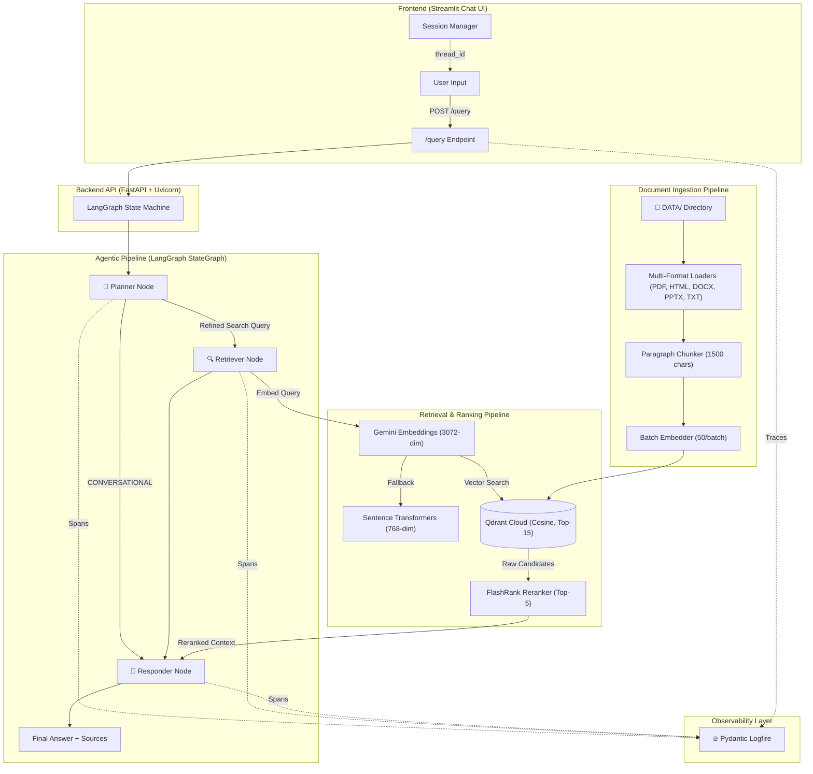
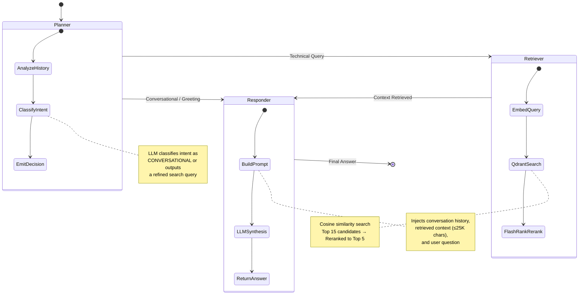

# 🧠 Enterprise Agentic RAG — Production-Grade Retrieval-Augmented Generation System

[](https://www.python.org/)
[](https://fastapi.tiangolo.com/)
[](https://langchain-ai.github.io/langgraph/)
[](https://qdrant.tech/)
[](https://streamlit.io/)
[](https://groq.com/)
[](https://ai.google.dev/)
[](https://pydantic.dev/logfire)

> **Enterprise Agentic RAG** is a production-grade, multi-stage Retrieval-Augmented Generation system built on **LangGraph** state-machine orchestration, **Qdrant** cloud vector search, and **FlashRank** cross-encoder reranking. It ingests enterprise documentation across multiple file formats, intelligently routes queries through a Planner → Retriever → Responder agentic pipeline, and delivers high-precision technical answers with full source provenance — all backed by distributed tracing via **Pydantic Logfire**.

---

## 🌟 Key Features

### 🤖 1. Agentic LangGraph Orchestration
* **Stateful Multi-Node Pipeline**: Implements a cyclic `StateGraph` with three purpose-built nodes — **Planner**, **Retriever**, and **Responder** — orchestrated via LangGraph's conditional routing and compiled with a `MemorySaver` checkpointer.
* **Intelligent Intent Classification**: The Planner node analyzes the full conversation history and the latest user message to decide whether the query is **conversational** (answerable from memory) or **technical** (requiring fresh document retrieval). It outputs either `"CONVERSATIONAL"` to skip retrieval, or a refined search query to route through the vector pipeline.
* **Thread-Based Conversational Memory**: Each user session is assigned a unique `thread_id`, enabling the agent to maintain persistent conversation context across multiple turns using LangGraph's `MemorySaver` checkpointer.

### 🔍 2. Hybrid Retrieval & Semantic Reranking
* **High-Dimensional Vector Search**: Queries are embedded into **3072-dimensional vectors** (Gemini `gemini-embedding-2-preview`) and searched against the Qdrant cloud collection using Cosine similarity, retrieving the top 15 candidate chunks.
* **Cross-Encoder Reranking**: Retrieved candidates are refined through **FlashRank** (`ms-marco-MiniLM-L-6-v2` ONNX model) — a blazing-fast, local cross-encoder that rescores all 15 candidates and returns only the **top 5 most semantically relevant** chunks.
* **Resilient Embeddings with Auto-Fallback**: The embedding service probes Gemini at startup; if the API is unreachable, it transparently falls back to a local **Sentence Transformers** model (`all-mpnet-base-v2`, 768-dim) — zero downtime, automatic dimension detection.
* **Exponential-Backoff Retry Logic**: Qdrant searches are wrapped with `tenacity` retries (3 attempts, exponential wait) and gracefully degrade to empty result sets on persistent failure.

### 📄 3. Universal Multi-Format Document Ingestion
* **5 Format Parsers**: The ingestion pipeline automatically detects and parses:
  * **PDF** — Primary extraction via `pypdf`, with `pdfplumber` as a fallback for image-heavy / scanned pages.
  * **HTML** — `BeautifulSoup` cleaning that strips scripts, styles, and metadata, then collapses whitespace.
  * **DOCX** — Native `python-docx` paragraph extraction.
  * **PPTX** — Native `python-pptx` slide-by-slide shape text extraction.
  * **TXT** — Direct file read with UTF-8 error tolerance.
* **Paragraph-Aware Chunking**: Documents are split on double-newline boundaries (`\n\n`) into semantically coherent chunks of up to **1500 characters**, preserving context across paragraph boundaries.
* **Batch Vectorization & Indexing**: Chunks are embedded in batches of 50 with built-in rate-limit retry (exponential backoff up to 4 attempts for Gemini `429` errors), then upserted into Qdrant with full source metadata payloads.
* **Noisy vs. True Data Separation**: The ingestion engine auto-classifies subdirectories into `true` or `noisy` source types based on folder naming, enabling provenance-aware retrieval.

### 🖥️ 4. Streamlit Chat Interface
* **Real-Time Conversational UI**: A responsive Streamlit dashboard with session management, unique session IDs, and chat history persistence.
* **Typewriter-Style Answer Streaming**: Final answers are rendered character-by-character with a blinking cursor effect (`▌`) for a polished, real-time experience.
* **Transparent Agent Reasoning**: The UI displays the agent's full **thought process** (planning → retrieval → generation steps) in a live status expander before presenting the answer.
* **Source Provenance Explorer**: Retrieved document chunks are displayed in nested expandable sections, letting users inspect the exact context the agent used to compose its answer.
* **One-Click Memory Wipe**: A sidebar button clears conversation history and resets the session thread, generating a fresh `thread_id`.

### 📡 5. Full-Stack Observability (Pydantic Logfire)
* **Distributed Tracing**: Every stage of the pipeline — from UI interaction, through backend invocation, to Qdrant search and LLM synthesis — is instrumented with `logfire` spans, producing a complete request waterfall.
* **FastAPI Auto-Instrumentation**: The backend API is instrumented via `logfire[fastapi]`, capturing request/response metrics, latencies, and error rates out of the box.
* **Structured Logging**: Uses `loguru` for enhanced Python logging alongside Logfire spans for structured, searchable observability.

---

## 🏗️ System Architecture & Data Flow



---

## 🔄 Agentic Pipeline — Node-by-Node Breakdown



---

## 🗂️ Agent State Schema

The LangGraph agent operates on a typed `AgentState` dictionary that flows through every node:

| Field | Type | Description |
| :--- | :--- | :--- |
| `messages` | `Annotated[List[dict], operator.add]` | Append-only conversation history (user + assistant messages). Uses `operator.add` for automatic accumulation across graph steps. |
| `current_query` | `str` | The planner's output — either `"CONVERSATIONAL"` or a refined technical search query. |
| `documents` | `List[str]` | Retrieved and reranked document chunks (formatted as `"CONTENT: <text>"`). |
| `plan` | `List[str]` | An evolving audit trail of the agent's reasoning steps (e.g., `"Intent: Technical"`, `"Search Term: ..."`, `"Context Retrieved"`). |
| `status` | `str` | Human-readable status message for the current pipeline stage. |
| `final_answer` | `str` | The LLM-synthesized response returned to the user. |

---

## 📂 Project Structure

```
Production_Grade_Advanced_RAG/
├── app/
│   ├── __init__.py
│   ├── config.py                         # Centralized settings (Groq, Qdrant, Gemini keys & endpoints)
│   ├── main.py                           # FastAPI application — /query, /graph endpoints + Logfire init
│   ├── agents/
│   │   ├── __init__.py
│   │   ├── state.py                      # AgentState TypedDict (messages, documents, plan, status, etc.)
│   │   ├── graph.py                      # LangGraph StateGraph definition, conditional routing & MemorySaver
│   │   └── nodes/
│   │       ├── __init__.py
│   │       ├── planner.py                # Intent classifier — routes CONVERSATIONAL vs. technical queries
│   │       ├── retriever.py              # Vector search (Qdrant) + semantic reranking (FlashRank)
│   │       └── responder.py              # LLM response synthesis with context injection & memory
│   ├── ingestion/
│   │   ├── __init__.py
│   │   ├── processor.py                  # Universal ingestion orchestrator — parse → chunk → embed → index
│   │   ├── chunking/
│   │   │   ├── __init__.py
│   │   │   └── splitter.py               # Paragraph-aware text chunker (1500 char limit)
│   │   └── loaders/
│   │       ├── __init__.py
│   │       ├── pdf.py                    # PDF loader (pypdf + pdfplumber fallback)
│   │       ├── html.py                   # HTML loader (BeautifulSoup sanitization)
│   │       ├── office.py                 # DOCX & PPTX loader (python-docx, python-pptx)
│   │       └── text.py                   # Plain text loader (UTF-8 with error tolerance)
│   └── services/
│       ├── __init__.py
│       └── retrieval/
│           ├── embeddings.py             # Gemini embeddings (3072-dim) with Sentence Transformers fallback
│           ├── qdrant_service.py          # Qdrant Cloud vector search with tenacity retry
│           └── ranking_service.py         # FlashRank cross-encoder reranker (ONNX, ms-marco-MiniLM)
├── ui/
│   └── app.py                            # Streamlit chat dashboard — session mgmt, streaming, source viewer
├── DATA/
│   ├── true_data/                        # Ground-truth enterprise documents (PPTX, DOCX, HTML, TXT)
│   ├── noisy_data/                       # Distractor / noisy documents (PDFs, mixed formats)
│   ├── noisy_sample_10/                  # 10-doc noisy sample subset
│   └── noisy_sample_15/                  # 15-doc noisy sample subset
├── processed_data/
│   ├── true/                             # Processed JSON metadata for true documents
│   └── noisy/                            # Processed JSON metadata for noisy documents
├── requirements.txt                      # All Python dependencies with category annotations
├── .env.example                          # Environment variable template
└── .env                                  # Active environment configuration (gitignored)
```

---

## ⚡ Quickstart & Installation

### Prerequisites
* **Python**: `3.10` or `3.11` recommended.
* **Groq API Key**: For ultra-fast LLM inference (Planner + Responder nodes).
* **Qdrant Cloud**: Active Qdrant Cloud cluster with an API key and endpoint URL.
* **Gemini API Key**: For high-dimensional embedding generation (`gemini-embedding-2-preview`).
* **Logfire Token** *(optional)*: For distributed tracing and observability.

### Step-by-Step Setup

1. **Clone the Repository**
   ```bash
   git clone https://github.com/your-username/Production_Grade_Advanced_RAG.git
   cd Production_Grade_Advanced_RAG
   ```

2. **Create & Activate Virtual Environment**
   ```bash
   # Windows (PowerShell)
   python -m venv .venv
   .\.venv\Scripts\Activate.ps1

   # macOS / Linux
   python -m venv .venv
   source .venv/bin/activate
   ```

3. **Install Dependencies**
   ```bash
   pip install -r requirements.txt
   ```

4. **Configure Environment Variables**
   Copy the example and fill in your API keys:
   ```bash
   cp .env.example .env
   ```
   Edit `.env`:
   ```dotenv
   GROQ_API_KEY=your-groq-api-key
   GROQ_FALLBACK_API_KEY=your-fallback-groq-key    # Optional
   GROQ_MODEL=your-groq-model-name

   QDRANT_API_KEY=your-qdrant-api-key
   QDRANT_CLUSTER_ENDPOINT=https://your-cluster.cloud.qdrant.io

   GEMINI_API_KEY=your-gemini-api-key

   LOGFIRE_TOKEN=your-logfire-token                 # Optional
   BACKEND_URL=http://localhost:8000                # Default
   ```

5. **Ingest Documents into Qdrant**
   ```bash
   # Ingest all documents from DATA/ (auto-classifies true vs. noisy subdirectories)
   python -m app.ingestion.processor DATA --wipe

   # Or ingest a specific subdirectory with an explicit source type
   python -m app.ingestion.processor DATA/true_data true
   ```

6. **Launch the Backend API**
   ```bash
   uvicorn app.main:app --host 0.0.0.0 --port 8000 --reload
   ```
   Verify at `http://localhost:8000` — you should see `{"message": "LangGraph RAG API is live."}`.

7. **Launch the Streamlit UI**
   ```bash
   streamlit run ui/app.py
   ```
   Navigate to `http://localhost:8501` and start chatting with your documents!

---

## 🔌 API Reference

| Method | Endpoint | Description |
| :--- | :--- | :--- |
| `GET` | `/` | Health check — returns `{"message": "LangGraph RAG API is live."}` |
| `GET` | `/graph` | Returns a PNG image of the compiled LangGraph agent workflow |
| `POST` | `/query` | Executes the full agentic RAG pipeline |

### `POST /query` — Request Body

```json
{
  "q": "How does Kubernetes pod autoscaling work?",
  "thread_id": "optional-session-id"
}
```

### `POST /query` — Response

```json
{
  "question": "How does Kubernetes pod autoscaling work?",
  "answer": "Kubernetes Horizontal Pod Autoscaler (HPA) automatically scales...",
  "thought_process": [
    "Intent: Technical",
    "Search Term: Kubernetes pod autoscaling HPA mechanism",
    "Context Retrieved"
  ],
  "status": "Response generated",
  "sources": [
    "CONTENT: The Horizontal Pod Autoscaler automatically scales the number of pods..."
  ]
}
```

---

## 🛠️ Tech Stack & Libraries

| Category | Technologies |
| :--- | :--- |
| **Backend API** | FastAPI, Uvicorn, Pydantic |
| **Agentic Orchestration** | LangGraph (StateGraph, MemorySaver), LangChain |
| **LLM Inference** | Groq Cloud (`langchain-groq`) — ultra-low-latency inference |
| **Embeddings** | Google Gemini `gemini-embedding-2-preview` (3072-dim), Sentence Transformers `all-mpnet-base-v2` (768-dim fallback) |
| **Vector Database** | Qdrant Cloud (Cosine similarity, `query_points` API) |
| **Semantic Reranking** | FlashRank (`ms-marco-MiniLM-L-6-v2`, local ONNX cross-encoder) |
| **Document Parsing** | `pypdf`, `pdfplumber`, `beautifulsoup4`, `python-docx`, `python-pptx` |
| **Frontend** | Streamlit (chat interface, session management, source explorer) |
| **Observability** | Pydantic Logfire (distributed tracing, FastAPI instrumentation), Loguru |
| **Resilience** | Tenacity (exponential-backoff retries for Qdrant), rate-limit retry for Gemini embeddings |
| **Utilities** | `python-dotenv`, `numpy`, `requests`, `uuid` |

---

## 🧪 Key Technical Details

### Embedding Dimensions & Fallback Strategy
The embedding service implements a **probe-at-startup** pattern:
1. On first call, it attempts a test embed with Gemini (`3072-dim`).
2. If Gemini is unreachable (network error, quota exhaustion), it transparently loads `all-mpnet-base-v2` locally (`768-dim`).
3. The active dimension is resolved at runtime and passed to Qdrant collection creation — no manual configuration needed.

### Retrieval Pipeline Parameters
| Parameter | Value | Description |
| :--- | :--- | :--- |
| Embedding Model (Primary) | `gemini-embedding-2-preview` | 3072-dimensional vectors |
| Embedding Model (Fallback) | `all-mpnet-base-v2` | 768-dimensional vectors |
| Vector Search Limit | 15 candidates | Initial broad recall from Qdrant |
| Reranker Model | `ms-marco-MiniLM-L-6-v2` | FlashRank ONNX cross-encoder |
| Reranker Top-N | 5 documents | Final precision-filtered context |
| Chunk Size | 1500 characters | Paragraph-aware splitting |
| Embed Batch Size | 50 texts/batch | Rate-limit friendly batching |
| Context Truncation | 25,000 characters | Max context window for Groq TPM limits |

### ⏱️ Empirical Latency Benchmarks (Measured)
Empirically measured across 10 real queries through the live LangGraph agent pipeline using `openai/gpt-oss-120b` on Groq, Gemini Embeddings, Qdrant Cloud, and FlashRank:

| Metric | Measured Value | Notes |
| :--- | :--- | :--- |
| **Mean End-to-End Latency** | **15.13s** | Includes planning, retrieval, reranking, and full generation |
| **Median Latency** | **15.12s** | Balanced across technical and conversational queries |
| **Minimum Latency** | **11.92s** | Short conversational greeting (`retrieval: skipped`) |
| **Maximum Latency** | **19.12s** | Multi-step technical query with full context synthesis |
| **Std Deviation** | **2.41s** | Consistent network & inference timing |

#### Measured Query Breakdown:
* **Technical Queries (with Qdrant retrieval + FlashRank rerank, n=8):**
  * Average: **~15.80s** (Range: 12.92s – 19.12s)
  * Breakdown: Intent classification (~1.5s) + Gemini vectorization & Qdrant search (~0.8s) + FlashRank local ONNX rerank (~0.2s) + Groq 120B comprehensive answer synthesis (~12s–16s).
* **Conversational Queries (retrieval skipped via Planner, n=2):**
  * Average: **12.39s** (Range: 11.92s – 12.86s)
  * Direct intent resolution + Groq 120B response generation.

### Retry & Resilience
* **Qdrant Search**: 3 attempts with exponential backoff (`1s → 2s → 5s max`), falls back to empty results.
* **Gemini Embeddings**: 4 attempts with exponential backoff (`1s → 2s → 4s → 8s`) on `429/rate/quota` errors.
* **Reranker**: Falls back to original Qdrant ordering if FlashRank fails.

---

## 📜 License

Distributed under the MIT License. See `LICENSE` for details.
